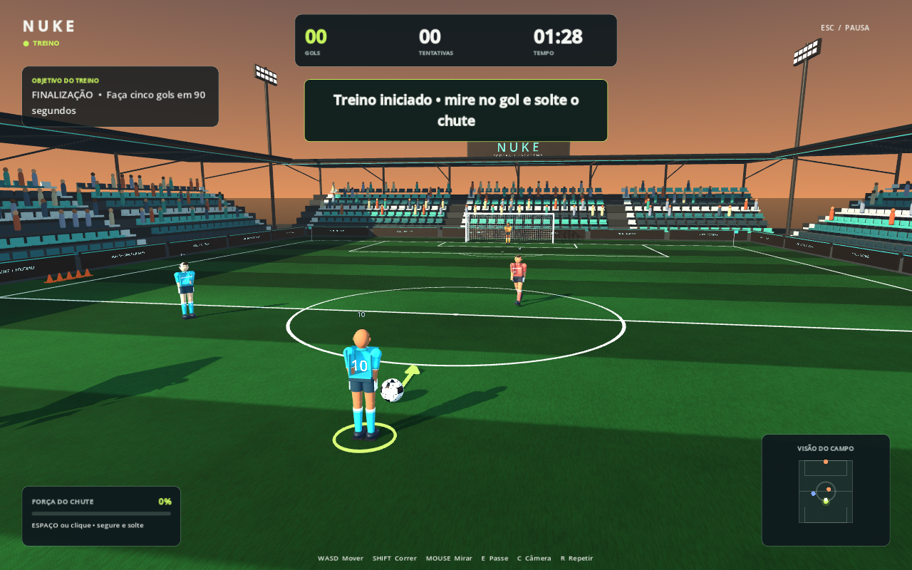

# Baixar NUKE FOOTBALL

- [Jogo para Windows (ZIP, cerca de 35 MB)](https://github.com/xraphor/game/raw/refs/heads/codex/nuke-football-download/downloads/NUKE-FOOTBALL-Windows.zip)
- [Projeto Godot completo (ZIP)](https://github.com/xraphor/game/raw/refs/heads/codex/nuke-football-download/downloads/NUKE-FOOTBALL-Projeto-Godot.zip)

Extraia o ZIP do jogo e abra `NUKE-FOOTBALL.exe`. Não é necessário instalar Godot ou Unreal para executar o binário. As instruções e licenças acompanham o pacote.

WASD move, Shift corre, mouse mira, segurar e soltar Espaço ou o botão esquerdo do mouse chuta, E passa, C troca a câmera, R repõe as posições e Esc pausa.

O projeto passou em 69 verificações de integração e foi executado em Linux. O executável Windows foi exportado, mas ainda precisa ser verificado em um PC Windows.

Os arquivos ficam nesta branch de distribuição. O projeto utiliza Godot 4.6.3 e os personagens têm visual original estilizado.

